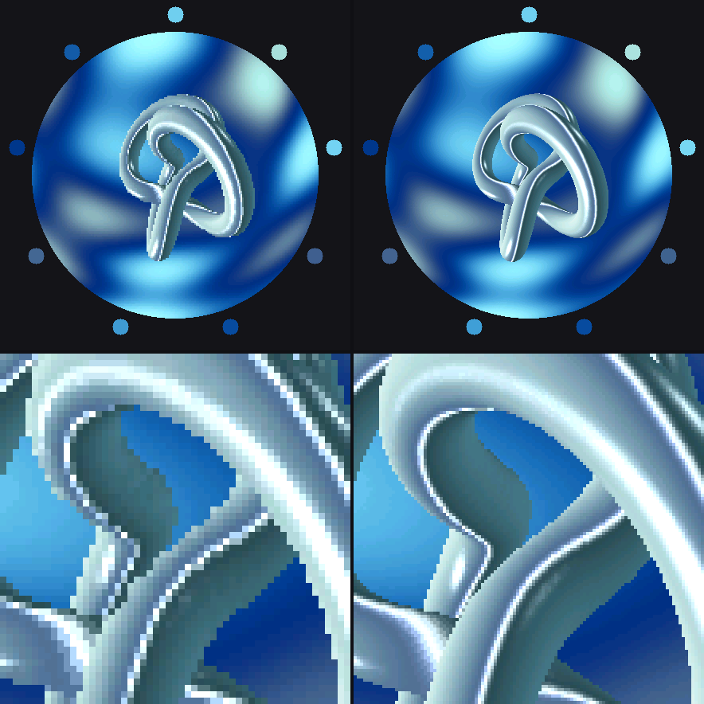
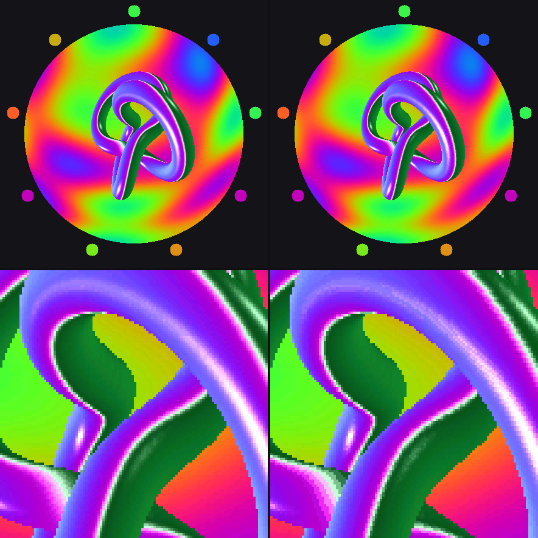
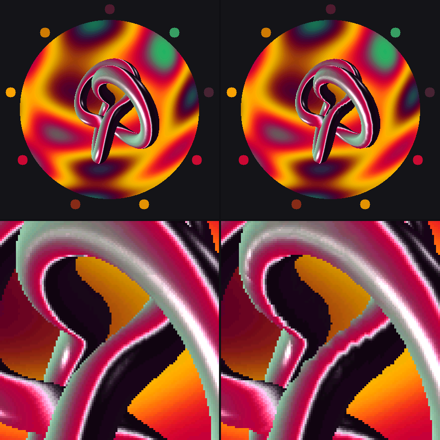
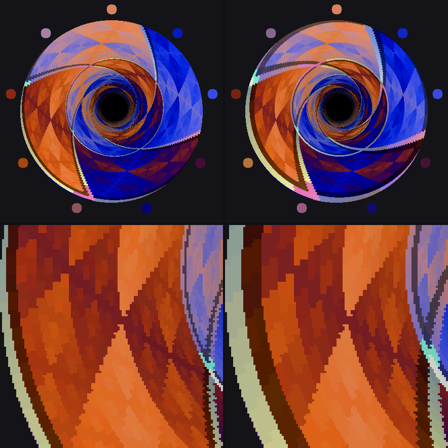
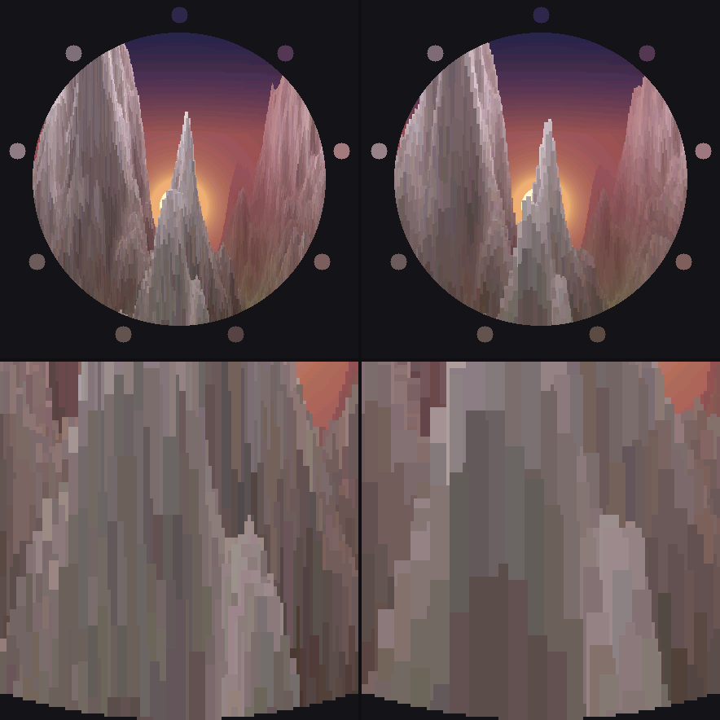
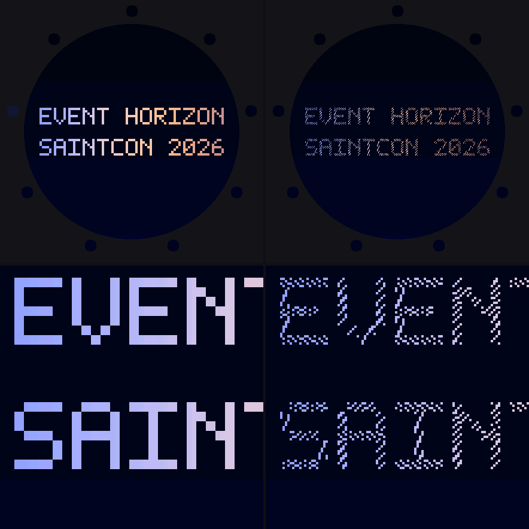
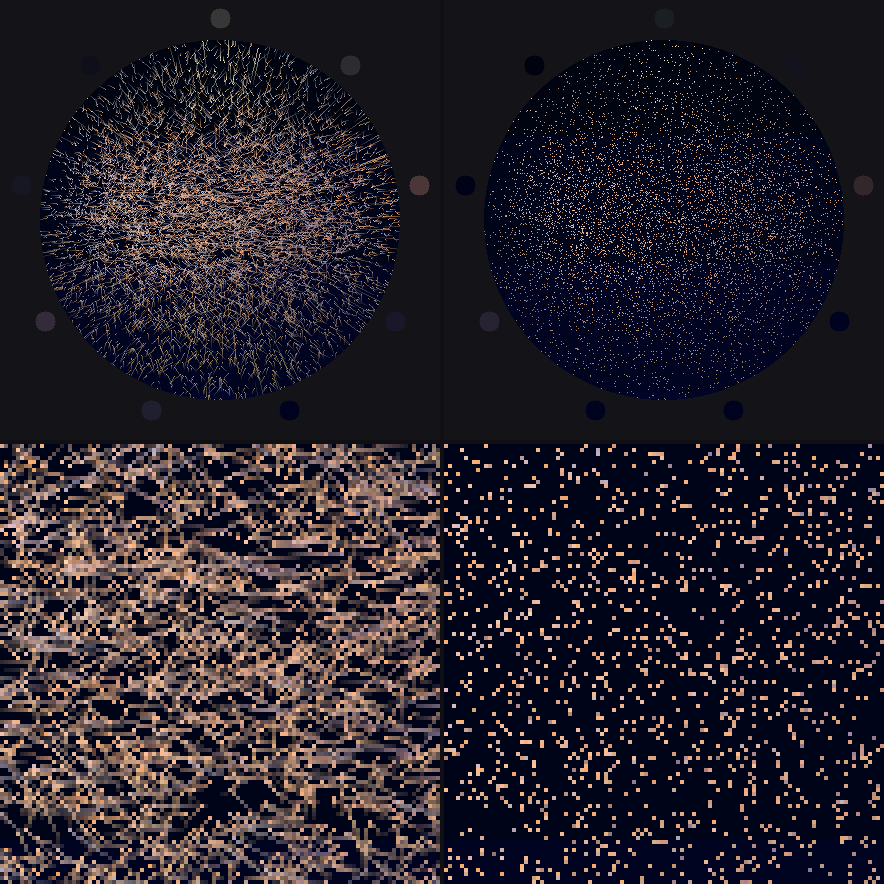
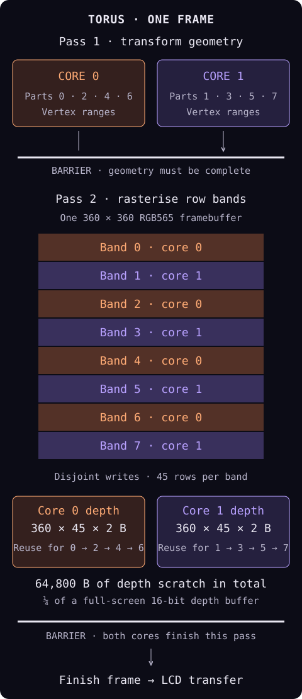

#+title: EVENT HORIZON comparisons: what the bytes buy
#+date: [2026-10-30 Fri]

These are *host renders*, including the simulated LED ring. The paired
frames use the same time, camera and palette. The torus comparisons use
different built-in palettes so each experiment has its own appearance:
ice for the early/native build comparison, spectrum for reflections and
ember for mesh density. No rendered pixels were retouched.

The native renderer is =b7fdd4c=; the early 180×180 reference is =5889e0d=.
Each directory's =manifest.json= records the renderer file hashes, generator
hash, palette-button inputs, frame time, framebuffer hashes and PNG hashes.
The historical references belong to development history; fresh public
snapshot repositories may not contain the early reference. These pictures
do not replace or redate the [[file:../native-360/README.org][October 29 timing and memory measurements]].

* Ice: early build versus native resolution

Early 180×180 build at left, native 360×360 at right, at 6 s. Below are
matching 4× crops. The smooth tube outline and small highlights survive
the native panel resolution. This compares whole builds: mesh, environment
map and other quality settings also changed. The following comparisons
isolate one quality setting at a time.

* Spectrum: the reflections have a resolution too

128×128 environment map at left, 64×64 at right, at 6 s. The geometry is
unchanged. Look at the steps along the reflected horizon inside the tube:
they come from sampling the environment map. The larger map costs 24,576 B
more in this workspace.

* Ember: where geometry becomes visible

160×16 mesh at left, 96×8 at right, at 6 s. The smaller mesh makes the
tube's outline and bends visibly polygonal. This is distinct from the
320-to-160 reduction described in the earlier measurement record: that
comparison showed only a faint facet at 4× zoom. This sheet compares the
current mesh against the much smaller early mesh.

* Tunnel: buy detail in the wall, save space in the mapping

128×128 wall texture at left, 64×64 at right, at 20 s. The brighter seam
and its adjacent shadow turn a flat texture into bevelled panels. At the
lower resolution, those seams become broad, coarse steps. The larger
texture costs 24,576 B more.

The screen-to-texture tables make a different trade: one quadrant is
mirrored into the other three, avoiding four copies while keeping 1,024
angular steps. This sheet changes the texture only; it is not evidence
for the independent lookup-table optimisation.

* Terrain: the foreground shows the missing samples

256×256 height/colour maps at left, 128×128 at right, at 30.5 s. The
foreground ridges acquire large steps when sampling is reduced. The
larger maps cost 147,456 B more; the configuration also retains the finest
noise octave and per-sample grain, so this is a map-quality comparison,
not just a resampling of one fixed heightfield.

The renderer visits columns front to back. A nearer ridge raises the
occlusion boundary, letting it skip hidden terrain farther away. Depth
testing needs a per-column horizon instead of a full-screen depth buffer.
The camera follows an envelope above the peaks to keep the view out of the
landscape.

* Particles: enough fragments to fill the letters

8,192 particles at left, 2,048 at right, at 48.5 s. Both spell the current
final title. Fewer fragments leave the letters visibly incomplete. Target
assignment permutes the letter pixels so they are covered before repeats.

* Trails: two positions on one path

Trails enabled at left, disabled at right, at 45 s. The enabled renderer
joins each particle's current position to its position 80 ms earlier.
Both positions come from the same analytic motion function. It stores
segments, not previous images; removing trails saves 32,768 B. The dots
at right show how much the strokes contribute to the sense of motion.

* Two cores, one picture

The diagram shows the torus's two-pass frame plan on the badge. Geometry
is complete before rasterisation starts. Eight horizontal bands write
disjoint pixels; each core reuses one 360×45 depth buffer for its four
bands. Both workers finish before the display transfer. Other effects
divide their work differently.

* Reproduce

#+begin_src sh
python3 -I -B tools/ablate.py --only v1-torus-plasma --palette 1 --out docs/measurements/comparisons-20261030/ice
python3 -I -B tools/ablate.py --only torus-env --palette 2 --out docs/measurements/comparisons-20261030/spectrum
python3 -I -B tools/ablate.py --only torus-mesh --palette 3 --out docs/measurements/comparisons-20261030/ember
python3 -I -B tools/ablate.py --only tunnel-tex,terrain-map,particle-count,particle-trails --palette 0 --out docs/measurements/comparisons-20261030/default
#+end_src

Palette selection sends brief A-button presses through the existing CLI.
Both sides must report the requested palette, yaw 0 and pitch 0; the
generator refuses a mismatch. The original 110-pixel crops are enlarged by
nearest-neighbour at 4×; no smoothing filter is used.
